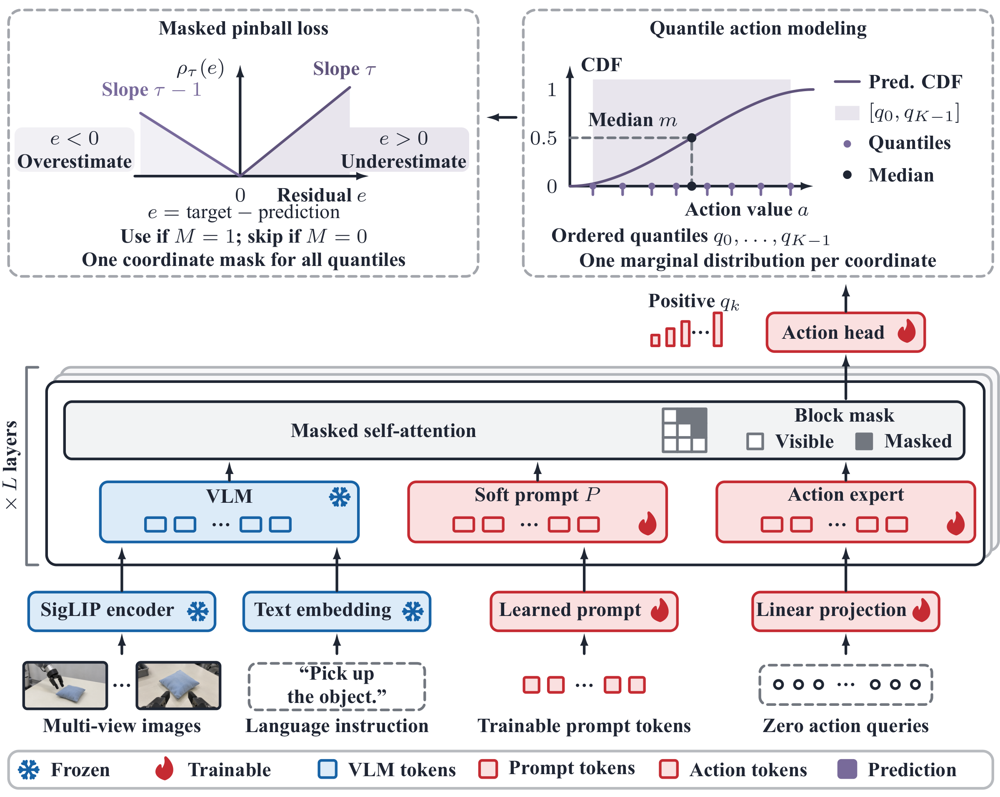
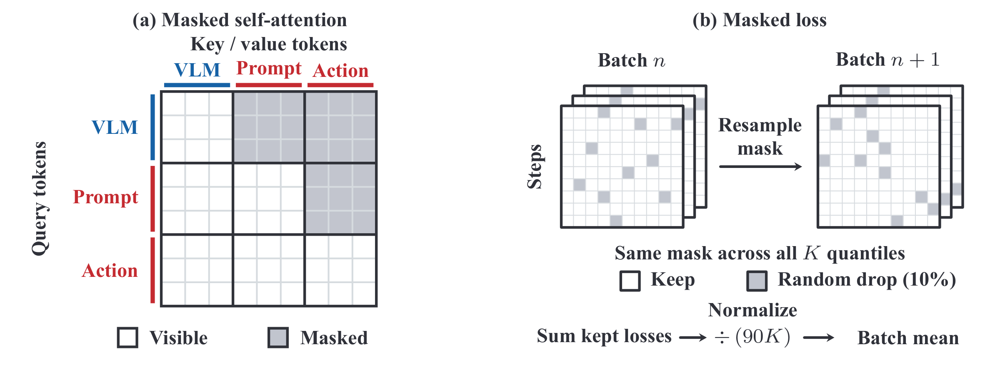

# Quantile Head for Vision-Language-Action Models

**Xuan Wang · Yinan Wu · Haoran Duan · Jungong Han**<br>
Department of Automation, Tsinghua University

[Method](#method) · [Results](#results) · [Getting started](#getting-started) · [Training and evaluation](docs/reproduction.md)

Quantile Head predicts **ordered marginal action quantiles in one forward pass**.
Joint quantile supervision trains a strong median policy, while the same head
supports quantile sampling at inference without retraining. Built on the π₀.₅
backbone, it combines a frozen vision-language model with learnable prompts and a
trainable action expert.

## Method



*Architecture from Figure 2 of the paper.*

- **Predict a median and positive gaps.** The head accumulates independently
  learned left and right gaps around the median to produce 21 noncrossing
  quantiles for each action coordinate.
- **Train all quantiles together.** Masked pinball loss supervises the quantiles
  with a shared coordinate mask, randomly withholding 10% of valid action labels.
  Sixteen learnable prompt tokens adapt the frozen VLM features for control.
- **Decode in one pass.** The default policy executes the median. Optional
  sampling interpolates the predicted marginal quantiles and can correlate
  quantile ranks across replanning steps.

<details>
<summary>Attention and loss masks (Figure 3)</summary>



Prompts attend to VLM and prompt features; action tokens attend to all three
groups. During training, each example receives a newly sampled coordinate-label
mask shared across all quantiles. The head models one marginal distribution per
action coordinate; sampling specifies how ranks are coupled across coordinates
and time.

</details>

## Results

The tables below compare Quantile Head with other methods on **LIBERO,
LIBERO-Pro, LIBERO-Plus, and two real-robot tasks** (Tables 1–3 of the paper).
Success rates are percentages (higher is better). Quantile Head uses
**deterministic median decoding**. External baselines retain their original
training and evaluation protocols.

**Bold** and <ins>underlined</ins> values in Tables 1–2 mark the best and
second-best results. Quantile Head benchmark rates average three training seeds.
LIBERO uses 1,000 episodes per suite and trained model; LIBERO-Plus covers all
10,030 benchmark instances per model; LIBERO-Pro uses 100 episodes per task and
model.

### Table 1. LIBERO and LIBERO-Pro

**(a) LIBERO**

| Method | Spatial | Object | Goal | Long | Avg. |
|---|---:|---:|---:|---:|---:|
| Diffusion Policy<sup>a</sup> | 78.3 | 92.5 | 68.3 | 50.5 | 72.4 |
| OpenVLA<sup>a</sup> | 84.7 | 88.4 | 79.2 | 53.7 | 76.5 |
| π₀-FAST<sup>a</sup> | 96.4 | 96.8 | 88.6 | 60.2 | 85.5 |
| π₀<sup>a</sup> | 96.8 | 98.8 | 95.8 | 85.2 | 94.2 |
| OpenVLA-OFT | 97.6 | 98.4 | 97.9 | 94.5 | 97.1 |
| π₀.₅ | 98.8 | 98.2 | 98.0 | 92.4 | 96.85 |
| VLANeXt | <ins>99.0</ins> | 99.2 | 96.6 | 94.8 | 97.4 |
| SimVLA | **99.6** | <ins>99.8</ins> | <ins>98.6</ins> | 96.4 | 98.6 |
| WLA-0 | <ins>99.0</ins> | **100.0** | 97.8 | 97.6 | 98.6 |
| InternVLA-A1.5 | 98.6 | <ins>99.8</ins> | <ins>98.6</ins> | <ins>98.4</ins> | <ins>98.9</ins> |
| Quantile Head | <ins>99.0</ins> | **100.0** | **99.6** | **98.6** | **99.3** |

Long denotes LIBERO-10. Avg. is the four-suite mean; source-reported precision is retained. <sup>a</sup>Results are from Kim et al., *Fine-tuning Vision-Language-Action Models: Optimizing Speed and Success* (OpenVLA-OFT), Table I. The OpenVLA-OFT row is also from that paper. The π₀.₅ reference is the official openpi 30k-step checkpoint reported in its LIBERO README. Other baselines follow their original papers.

**(b) LIBERO-Pro**

| Method | Object | Position | Semantic | Task | Avg. |
|---|---:|---:|---:|---:|---:|
| OpenVLA | <ins>93.0</ins> | 0.0 | 97.3 | 0.0 | 47.6 |
| π₀ | 90.5 | 0.0 | 90.5 | 0.0 | 45.3 |
| π₀.₅ | **96.0** | <ins>20.8</ins> | 95.8 | 0.8 | <ins>53.3</ins> |
| MolmoAct | 76.0 | 1.5 | 85.8 | 1.5 | 41.2 |
| X-VLA | 79.0 | 0.8 | 96.8 | 6.8 | 45.8 |
| OpenVLA-OFT<sup>b</sup> | 27.6 | 5.8 | 59.0 | 0.6 | 23.3 |
| X-VLA (CR eval.)<sup>b</sup> | 78.4 | 1.6 | 82.9 | 16.4 | 44.8 |
| VLA-Adapter<sup>b</sup> | 73.8 | 0.0 | 90.8 | <ins>19.8</ins> | 46.1 |
| SimVLA | 81.5 | 8.3 | **98.8** | 6.0 | 48.6 |
| SUREFlow | 68.5 | 0.0 | 87.8 | 0.0 | 39.1 |
| **Quantile Head** | 85.8 | **31.3** | <ins>97.8</ins> | **26.0** | **60.2** |

Each perturbation category averages Spatial, Object, Goal, and Long; Avg. averages the four categories, excluding Original and Environment. Quantile Head uses its LIBERO-trained checkpoint without Pro fine-tuning. The first five baselines use the official LIBERO-Pro leaderboard. <sup>b</sup>Results are from Wu et al., *Continuous Reasoning for Vision-Language-Action*. SimVLA and SUREFlow use their original reports.

### Table 2. LIBERO-Plus

**(a) Zero-shot transfer** — LIBERO-trained policies without further training.

| Method | Camera | Robot | Language | Light | Background | Noise | Layout | Total |
|---|---:|---:|---:|---:|---:|---:|---:|---:|
| OpenVLA<sup>a</sup> | 0.8 | 3.5 | 23.0 | 8.1 | 34.8 | 15.2 | 28.5 | 15.6 |
| π₀-FAST<sup>a</sup> | 65.1 | 21.6 | 61.0 | 73.2 | 73.2 | 74.4 | 68.8 | 61.6 |
| π₀<sup>a</sup> | 13.8 | 6.0 | 58.8 | 85.0 | 81.4 | 79.0 | 68.9 | 53.6 |
| OpenVLA-OFT<sup>a</sup> | 56.4 | 31.9 | 79.5 | 88.7 | 93.3 | 75.8 | 74.2 | 69.6 |
| π₀.₅<sup>b</sup> | 75.8 | 79.4 | 83.3 | 95.5 | <ins>95.0</ins> | 89.6 | 87.0 | <ins>85.7</ins> |
| VLANeXt | <ins>90.4</ins> | 65.7 | 81.8 | 95.9 | 82.5 | 94.1 | 80.8 | 83.9 |
| GAM | 83.1 | 70.0 | <ins>84.8</ins> | **97.2** | 94.3 | <ins>95.3</ins> | 79.1 | 85.5 |
| GE-Act 2.0 | **94.1** | 50.7 | 81.4 | 94.0 | 60.5 | **95.5** | 83.1 | 80.4 |
| ACoT-VLA<sup>b</sup> | 68.9 | <ins>80.3</ins> | 84.1 | 95.6 | 93.1 | 81.5 | **88.3** | 83.6 |
| Quantile Head | 71.6 | **80.7** | **87.6** | <ins>96.1</ins> | **97.2** | 94.8 | <ins>87.8</ins> | **87.1** |

**(b) Supervised fine-tuning** — uses LIBERO-Plus training data.

| Method | Camera | Robot | Language | Light | Background | Noise | Layout | Total |
|---|---:|---:|---:|---:|---:|---:|---:|---:|
| π₀<sup>b</sup> | 79.6 | 21.1 | 72.5 | 84.7 | 86.2 | 68.3 | 69.4 | 67.4 |
| π₀.₅<sup>b</sup> | 70.3 | 41.7 | 81.1 | <ins>97.3</ins> | 94.6 | 71.8 | <ins>84.9</ins> | 75.7 |
| OpenVLA-OFT+ | <ins>92.8</ins> | 30.3 | <ins>85.8</ins> | 94.9 | 93.9 | 89.3 | 77.6 | 79.6 |
| MemoryVLA<sup>d</sup> | 91.4 | 48.6 | 79.4 | 95.2 | 95.3 | 94.0 | 75.7 | 81.9 |
| MemoryVLA++ | **96.8** | 49.7 | 71.0 | 96.6 | <ins>97.0</ins> | **96.0** | 78.6 | 82.7 |
| ACoT-VLA<sup>b</sup> | 91.2 | <ins>62.5</ins> | 80.3 | 95.1 | 91.5 | 88.3 | <ins>84.9</ins> | <ins>84.1</ins> |
| Quantile Head (SFT) | 88.6 | **77.0** | **86.2** | **97.4** | **97.3** | <ins>94.1</ins> | **87.3** | **89.1** |

Source superscripts are local to Table 2: <sup>a</sup>Fei et al., *LIBERO-Plus*; <sup>b</sup>Zhong et al., *ACoT-VLA*; <sup>d</sup>Shi et al., *MemoryVLA++*. Unmarked baselines use their original papers. The π₀ and π₀.₅ SFT results from ACoT-VLA freeze the LLM backbone. Baseline totals follow each source's aggregation. Quantile Head pools all 10,030 benchmark instances for Total and reports the mean over three training seeds; Total is instance-weighted, not an unweighted mean of categories or suites.

### Table 3. Real-robot evaluation

| Real-robot task | π₀.₅ | Quantile Head | Gain (percentage points) |
|---|---:|---:|---:|
| Place apple on yellow plate | 31 | 52 | +21 |
| Remove cuboid from blue plate | 86 | 98 | +12 |
| Average | 58.5 | 75.0 | +16.5 |

The π₀.₅ baseline is fully fine-tuned. Both methods use the same demonstration data, optimization settings, and evaluation conditions.

## Getting started

The implementation uses the policy name **`quantile_head`** within LeRobot.
For LIBERO experiments, use Python 3.12+, Linux, a CUDA-enabled PyTorch
environment, FFmpeg, and MuJoCo rendering dependencies.

```bash
git clone https://github.com/xwangrs/Quantile-Head-for-VLA.git
cd Quantile-Head-for-VLA
uv sync --extra training --extra evaluation --extra pi --extra libero
export MUJOCO_GL=egl
```

Prepare a LeRobot-format dataset and compatible π₀.₅ initialization weights for
training, or a trained Quantile Head checkpoint for evaluation. Model weights,
datasets, and benchmark assets are obtained separately.

The [training and evaluation guide](docs/reproduction.md) provides the complete
commands, dataset requirements, paper evaluation protocols, sampling options,
and checkpoint format. The policy dependency extra is named `pi`.

## Code structure

| Path | Purpose |
| --- | --- |
| [`src/lerobot/policies/quantile_head/`](src/lerobot/policies/quantile_head/) | Model, ordered quantiles, masked loss, prompts, sampling, and processors |
| [`src/lerobot/scripts/lerobot_train.py`](src/lerobot/scripts/lerobot_train.py) | Single-GPU and distributed training |
| [`src/lerobot/scripts/lerobot_eval.py`](src/lerobot/scripts/lerobot_eval.py) | Simulation evaluation and rollout outputs |
| [`src/lerobot/scripts/quantile_head_eval_decoders.py`](src/lerobot/scripts/quantile_head_eval_decoders.py) | Evaluation-only decoding ablations |
| [`sh/`](sh/README.md) | Training variants and sampling experiments |
| [`docs/reproduction.md`](docs/reproduction.md) | Installation, training, evaluation, and checkpoint instructions |

## Acknowledgments and license

This repository builds on [Hugging Face LeRobot](https://github.com/huggingface/lerobot)
and its implementation of [Physical Intelligence OpenPI](https://github.com/Physical-Intelligence/openpi).
We thank these projects and the LIBERO, LIBERO-Plus, and LIBERO-Pro benchmark
authors. The code retains the upstream [Apache License 2.0](LICENSE) and source
copyright notices. Weights, datasets, and benchmark assets retain their respective
licenses.
